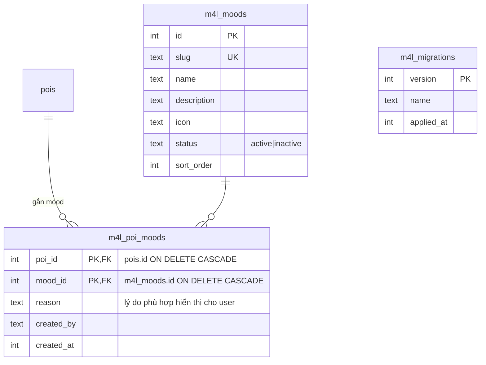

# M4L 2.0 — Kiến trúc

Nguyên tắc: **mở rộng, không thay thế**. M4L là một blueprint Flask mới + một giao diện vanilla JS mới, đặt cạnh các phần đang chạy. Không sửa logic `/`, `/admin`, `/cms/*`, `/dashboard/*`, kiosk.

## 1. Thành phần

```
server/m4l.py              Blueprint: trang /m4l*, API /api/m4l/*, feature flag, kiểm tra quyền
server/m4l_service.py      Nghiệp vụ thuần (validate, xếp hạng, random, cấu hình) — không phụ thuộc Flask request
server/m4l_exploration.py  Khu vực, lưới ô, kiểm tra mẫu GPS, mở khóa, ghim bí ẩn
server/m4l_migrations.py   Migration có version, backup SQLite trước khi áp dụng, CLI status/migrate/backup/downgrade
web/m4l/index.html         Shell mobile-first: /m4l (Home), /m4l/discover (Mood & Discovery), /m4l/world (Fog of War)
web/m4l/world.js           Bản đồ sương mù (MapLibre có sẵn, nạp khi vào trang)
web/m4l/m4l.js, m4l.css    UI người dùng
web/m4l/admin.html, admin.js  /m4l/admin: quản lý mood, gán mood cho POI (S0/CONTENT)
tests/test_m4l.py          Kiểm thử Phase 1
tests/test_m4l_phase2.py   Kiểm thử Phase 2
```

Đăng ký trong `server/app.py`: import blueprint, `app.register_blueprint(m4l)`, gọi `init_m4l()` trong `create_app()` sau `init_db()`.

## 2. Tái sử dụng

| Cần | Dùng lại |
|---|---|
| Đăng nhập, phiên | Token CMS (`/api/cms/login`, `localStorage['x24_cms_token']`), giải mã giống `cms.authenticate` |
| Phân quyền | `cms_accounts.role` + `cms.in_scope()` theo phường; S0 qua bảng `users` |
| Quy tắc POI hiển thị | Cùng điều kiện `status='published'` + `cms_pins` còn hiệu lực như `/api/public/pois` |
| Chi tiết POI | `/api/public/pois/<id>` (không nhân bản) |
| Truy cập DB | `db.q`, `db.ex`, `db.get_db` (chạy cả SQLite và Postgres) |
| Nhật ký | Bảng `audit` (cùng cột với `auth.audit`) |
| Icon, logo | `web/js/icons.js`, `web/assets/logo.png` |
| Chỉ đường | Link `/?mode=web&poi=<id>&dir=foot&locate=1` (giống `/dashboard/user`) |

## 3. Feature flag

`XANH24_M4L_ENABLED=1|true|yes|on` bật module. Mặc định **tắt**:
- `init_m4l()` không tạo bảng, không ghi DB.
- Mọi request tới blueprint (trang + API) → 404, như route chưa tồn tại.

Bật cờ khi DB đã có migration đang chờ → backup SQLite trước, rồi migrate. Backup lỗi → không migrate, module trả 503 `M4L_UNAVAILABLE`, phần còn lại của app vẫn chạy.

## 4. Data model / ERD

Ký hiệu: ✅ đã triển khai (Phase 1) · 🟡 *proposed* (chưa có code).



| Bảng | Trạng thái | Phase | Ghi chú mapping thật |
|---|---|---|---|
| `m4l_migrations` | ✅ | 1 | Version migration M4L, độc lập `db.MIGRATIONS` |
| `m4l_moods` | ✅ | 1 | |
| `m4l_poi_moods` | ✅ | 1 | FK vào `pois.id` thật, không sao chép POI |
| `m4l_areas`, `m4l_cells` | ✅ | 2 | Khu vực tham chiếu `wards.slug`; ô = tâm nằm trong `wards.geometry`; PK `(area_id, grid_version, cell_id)` |
| `m4l_user_unlocks` | ✅ | 2 | PK `(account_id, area_id, grid_version, cell_id)` → mở khóa idempotent. Không đặt FK sang `cms_accounts` vì `init_db()` có thể đổi tên bảng đó khi nâng cấp |
| `m4l_location_state` | ✅ | 2 | Một dòng/người: vị trí hợp lệ gần nhất (≈11 m) + thời điểm thử gần nhất |
| `m4l_mystery_pins` | ✅ | 2 | Lưu tọa độ (không lưu cell_id) để sống sót khi đổi lưới; `poi_id` FK `ON DELETE SET NULL` |
| `m4l_discovery_events` | ✅ | 2 | Log random: POI, mood, cỡ pool, lý do, `sponsored`, `campaign_id` (để trống tới Phase 4); dùng luôn làm bộ đếm quota |
| `m4l_partners`, `m4l_partner_locations` | 🟡 | 3–4 | Tái dùng `cms_accounts` OWNER + `cms_assignments` (OWNER ↔ POI) thay vì bảng partner trùng lặp; chỉ thêm bảng cho thông tin chưa có (verified_at) |
| `m4l_campaigns`, `m4l_placements` | 🟡 | 4 | |
| `m4l_voucher_templates`, `m4l_user_vouchers` | 🟡 | 3 | `token_hash` UNIQUE, server time |
| `m4l_kiosk_checkins` | 🟡 | 4 | `device_id` → `devices.id`; cần khóa thiết bị mới |
| `m4l_analytics_events` | 🟡 | 4 | Có `event_id` UNIQUE để chống đếm trùng; bảng `events` cũ giữ nguyên |
| Audit | ✅ dùng lại bảng `audit` | 1 | action `m4l.mood.create`, `m4l.mood.update`, `m4l.poi_moods.set` |

Thời gian lưu Unix epoch giây (UTC) như toàn bộ codebase; hiển thị theo `Asia/Ho_Chi_Minh` ở client.

## 5. API contract

Phong cách theo codebase hiện có: thành công trả object/`{items,...}`; lỗi trả `{"error": "<thông điệp tiếng Việt>", "code": "<MÃ_MÁY>"}`. Auth: `Authorization: Bearer <token CMS>`; không dùng cookie → không cần CSRF.

### Phase 1 — ✅ đã triển khai

| Method | Path | Auth | Mô tả |
|---|---|---|---|
| GET | `/m4l`, `/m4l/discover` | — | Trang người dùng |
| GET | `/m4l/admin` | — (trang); API kiểm tra quyền | Trang quản trị mood |
| GET | `/api/m4l/home` | Tùy chọn | `{user, moods[], features{discovery,random,exploration,vouchers}, progress:null}` — `user` chỉ có khi token USER hợp lệ (`display_name`, `first_name`) |
| GET | `/api/m4l/moods` | — | Mood `active`, kèm `poi_count` (chỉ đếm POI hiển thị công khai) |
| GET | `/api/m4l/discovery` | — | Query: `mood` (slug), `q` (≤100 ký tự), `category`, `lat`+`lng`, `radius` (m, 100–50000, cần lat/lng), `limit` (1–50, mặc định 20), `cursor` (offset). Trả `{mood, items[], total, next_cursor, sort}` |
| GET | `/api/m4l/admin/moods` | S0, CONTENT | Tất cả mood (kể cả inactive) |
| POST | `/api/m4l/admin/moods` | S0 | Tạo mood |
| PUT | `/api/m4l/admin/moods/<id>` | S0 | Sửa (tên, mô tả, icon, status, sort_order; slug không đổi) |
| GET | `/api/m4l/admin/pois?q=&mood=` | S0, CONTENT | POI trong phạm vi phường + mood đã gán |
| PUT | `/api/m4l/admin/pois/<poi_id>/moods` | S0, CONTENT (trong phường) | `{moods:[{id, reason}]}` thay toàn bộ tập mood của POI |

Mã lỗi Phase 1: `INVALID_PARAMETER`, `INVALID_LOCATION`, `MOOD_NOT_FOUND`, `UNAUTHENTICATED`, `FORBIDDEN`, `NOT_FOUND`, `CONFLICT`, `M4L_UNAVAILABLE`.

Item discovery: `id, name, category, category_name, ward_slug, ward_name, address, description (≤180), image, hours, lat, lng, distance_m (khi có vị trí), reasons[] (lý do gán mood), moods[] (slug), sponsored:false`.

### Phase 2 — ✅ đã triển khai

| Method | Path | Auth | Mô tả |
|---|---|---|---|
| GET | `/m4l/world` | — | Trang bản đồ sương mù |
| POST | `/api/m4l/discovery/random` | USER | Body `{mood?, q?, category?, lat?, lng?, radius?}` → `{item | null, reason, pool_size, remaining}`; 429 `COOLDOWN`/`QUOTA_EXCEEDED`; pool rỗng → `item:null, code:NO_ELIGIBLE_POI` (không tốn lượt) |
| GET | `/api/m4l/exploration?area=` | Tùy chọn | `{area (dlat,dlng,grid_version…), cells[], rules, unlocked[], progress, pins[]}` — khách: không có ô đã mở |
| POST | `/api/m4l/exploration/unlock` | USER | `{area?, samples:[{lat,lng,accuracy,t(ms)}]}` → `{unlocked, already_unlocked, cell_id, progress, revealed_pins}`; 422 `LOCATION_TOO_INACCURATE`/`INSUFFICIENT_SAMPLES`/`LOCATION_INCONSISTENT`/`IMPLAUSIBLE_MOVEMENT`/`OUTSIDE_AREA`; 429 `RATE_LIMITED` |
| GET | `/api/m4l/exploration/progress?area=` | USER | `{unlocked, eligible, percentage, grid_version, area}` |
| DELETE | `/api/m4l/exploration/me` | USER | Xóa ô đã mở + vị trí gần nhất |
| GET | `/api/m4l/mystery-pins?area=` | Tùy chọn | Ghim đã xuất bản; chưa mở chỉ có `teaser` + tâm ô |
| GET/POST | `/api/m4l/admin/areas` | GET S0/CONTENT · POST S0 | Khu vực + sinh lưới |
| POST | `/api/m4l/admin/areas/{id}/regenerate` | S0 | Đổi kích thước ô → `grid_version+1` |
| PUT | `/api/m4l/admin/areas/{id}` | S0 | `{status}` |
| GET/POST | `/api/m4l/admin/pins` | S0, CONTENT (khu nằm trọn trong phường được giao) | Ghim bí ẩn |
| PUT | `/api/m4l/admin/pins/{id}` | như trên | Sửa / xuất bản / lưu trữ |

### Phase 3–4 — 🟡 proposed (chưa có code)

| Method | Path | Auth | Phase |
|---|---|---|---|
| POST | `/api/m4l/vouchers/claim` | USER | 3 |
| GET | `/api/m4l/vouchers/me` | USER | 3 |
| POST | `/api/m4l/vouchers/redeem` | OWNER (nhân viên đối tác) | 3 |
| GET/POST | `/api/m4l/partner/campaigns` | OWNER | 4 |
| POST | `/api/m4l/admin/campaigns/<id>/review` | S0/AREA/CONTENT theo scope | 4 |
| POST | `/api/m4l/kiosk/check-in` | Khóa thiết bị | 4 |
| GET | `/api/m4l/admin/analytics` | S0 | 4 |

## 6. Thuật toán Discovery v1 (đã triển khai)

1. **Lọc** (SQL): POI hiển thị công khai (`published` + `cms_pins` hợp lệ) **AND** có tọa độ **AND** (nếu có `mood`) có liên kết tới mood đó với mood `active` **AND** `category` **AND** từ khóa (`name/address/description/tags`, `LIKE`).
2. **Bán kính** (Python, haversine `geoutil.haversine_m`) nếu có `lat/lng/radius`.
3. **Xếp hạng** xác định:
   - Có vị trí: `distance_m ASC, completeness DESC, id ASC`.
   - Không có vị trí: `completeness DESC, featured DESC, published_at DESC, id ASC`.
   - `completeness` = số trường có dữ liệu trong {ảnh, mô tả, giờ mở cửa, điện thoại, địa chỉ}.
4. **Phân trang** offset (`cursor`) trên thứ tự cố định.
5. Phase 1 không có sponsored; `sponsored` luôn `false`. Phase 4 chèn slot tài trợ vào **vị trí riêng có nhãn**, không đổi tập lọc.

Quy mô hiện tại (67 POI) cho phép xếp hạng trong bộ nhớ. Khi > vài nghìn POI: thêm bbox prefilter bằng SQL (`lat BETWEEN … AND lng BETWEEN …`).

## 7. Bảo mật & riêng tư (Phase 1)

- SQL tham số hóa toàn bộ; tên cột không lấy từ input.
- Không nhận `user_id` từ client; danh tính lấy từ token.
- Nội dung mood/lý do do quản trị nhập được escape khi render (`esc()`), giới hạn độ dài server-side.
- Vị trí: chỉ lấy khi user bấm “Gần tôi”; client làm tròn 3 chữ số thập phân trước khi gửi; server không lưu.
- Token hết hạn/không hợp lệ ở API tùy chọn → coi như khách (không lỗi), client xóa token.


## 8. Thương mại: voucher, tài trợ, VIP, kiosk (Phase 3–4)

```
Người dùng ──/m4l──► discovery / random / kiosk check-in ──► m4l_commerce.live_campaigns()
                         │  (offer + nhãn Tài trợ)                 │ approved · trong lịch · đối tác active
                         ▼                                         │ · còn quản lý POI · POI công khai · còn hạn mức
                   POST /vouchers/claim ──► m4l_vouchers (60′ theo giờ server, QR /m4l/v/<mã>)
                                                │
Đối tác (OWNER) ──/m4l/partner──► check / redeem ──► MockPOS ──► m4l_events(redeem) ──► /m4l/admin analytics
Trạm (devices + m4l_kiosk_keys) ──/m4l/station──► mã check-in 1 lần ──► /m4l/k/<mã> ──► ưu đãi trong bán kính
```

- Module: `server/m4l_commerce.py`. Route trong `server/m4l.py`. Bảng v4: xem `DATABASE_DESIGN.md`.
- Vai trò: PARTNER=OWNER, MANAGER=AREA, ADMIN=S0 (`DECISION_LOG.md` DL-01).
- Cấu hình (`m4l_config`): `random_mode`, `random_vip_fallback`, `voucher_default_ttl_min`, `kiosk_radius_m`, `kiosk_ticket_ttl_s`, `kiosk_tickets_per_min`, `kiosk_claim_window_s`.
- API: `API_CONTRACT.md`.
